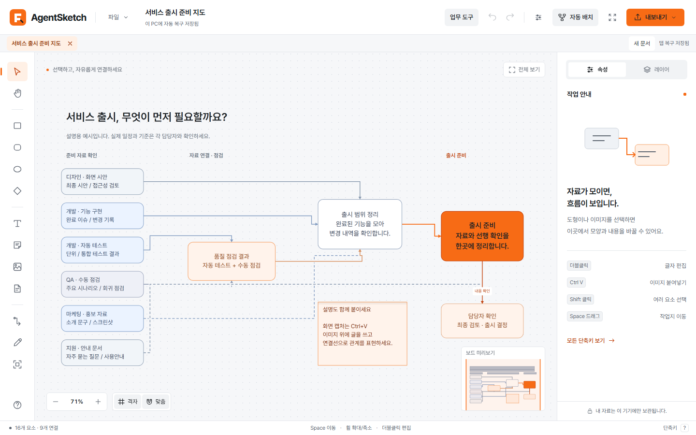
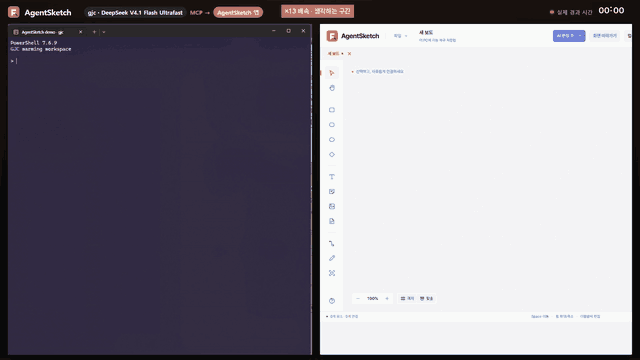

<div align="center">


# AgentSketch <sup>Beta</sup>

**자료와 절차의 관계를 한 장에 — 가볍고 오프라인으로 동작하는 Windows 플로우차트 편집기**

[](https://github.com/devjay4561/AgentSketch/actions/workflows/ci.yml)
[](https://github.com/devjay4561/AgentSketch/releases)
[](LICENSE)


[웹사이트](https://devjay4561.github.io/AgentSketch/) ·
[다운로드](https://github.com/devjay4561/AgentSketch/releases/latest) ·
[사용안내](docs/사용안내.md) ·
[AI 제어](docs/AI-사용안내.md) ·
[기여하기](CONTRIBUTING.md) ·
[English](README.en.md)




<sub>대본 없는 실제 세션: gjc + DeepSeek V4.1 Flash가 MCP로 실행 중인 앱에 직접 그립니다 (생각하는 구간 13배속, 그리는 구간 2배속)</sub>

</div>

## 왜 AgentSketch인가

큰 종이에 그리듯 도형·글·메모·이미지를 놓고 연결선으로 이어서, **어떤 자료가 어디서 와서 무엇의 선행 조건이 되는지**를 설명합니다. 화면 캡처를 붙여넣고 그 위에 설명을 쓰는 작업에 맞춰 설계했습니다.

- 🪶 **가벼움** — 약 22MB 단일 실행 파일. Node 서버나 Chromium 배포본 없이 Windows WebView2로 실행하고, 편집이 없을 때는 다시 그리지 않습니다.
- 🔒 **로컬 우선** — 기본 편집·저장·내보내기는 모두 이 PC에서 동작합니다. OCR, AI 요청, LAN 공동 작업은 사용자가 직접 켤 때만 네트워크를 사용합니다.
- 🧭 **관계 중심** — 장애물을 피하는 직각 연결선, 경유점, 조건부 선행 관계, 자료 출처·버전·확인 기록, 변경 영향 추적.
- 🤖 **AI 에이전트 친화적** — 104개 명령을 CLI와 MCP(stdio)로 제공해 Claude·Codex 같은 에이전트가 문서를 만들고 편집할 수 있습니다.
- 📤 **어디로든 내보내기** — PNG·SVG·PDF(벡터 글꼴)·편집 가능한 PPTX·HTML·CSV·draw.io.

## 주요 기능

| 분야 | 지원 범위 |
| --- | --- |
| 작업지 | 포인터 기준 확대·축소, Space+드래그 이동, 전체 보기, 미니맵, 격자·요소 맞춤 |
| 요소 | 사각형, 둥근 사각형, 타원, 마름모, 텍스트, 메모, 이미지(자르기·회전), 표, 체크리스트, 영역 상자, 자유 그리기 |
| 연결 | 직각·직선·곡선, 장애물 우회, 경유점 최대 32개, 라벨, 색·점선·두께, 단방향·양방향 화살표 |
| 정리 | 정렬·같은 간격, 중첩 그룹, 페이지·레이어, 좌→우·위→아래·트리·방사형·담당자별 자동 배치(미리보기 후 적용) |
| 자료 추적 | 출처·버전·담당자·기한·원본 지문, 사용자 정의 필드, 조건부 선행 관계, 준비 상태·누락·변경 영향 분석 |
| 문서 | 여러 문서 탭, 문서 카드로 다른 `.agentsketch` 연결, 첨부 파일, 스냅샷·보관 버전, 댓글·북마크·발표 모드 |
| 보관 | 이미지가 포함된 `.agentsketch`(JSON), 최근 보드 자동 복구, 실행 취소·다시 실행 |
| 가져오기·내보내기 | PNG, SVG, PDF, PPTX, HTML, CSV, draw.io / CSV·draw.io 가져오기 |

전체 조작과 단축키는 [사용안내](docs/사용안내.md), 구현 범위와 제약은 [업그레이드 범위](docs/업그레이드범위.md)를 참고하세요.

## 설치

### 실행 파일 (권장)

[Releases](https://github.com/devjay4561/AgentSketch/releases/latest)에서 `AgentSketch-Windows.zip`을 내려받아 압축을 풀고 `AgentSketch.exe`를 실행합니다.

- Windows 10/11 x64, [Microsoft Edge WebView2 Runtime](https://developer.microsoft.com/microsoft-edge/webview2/) (Windows 11에는 기본 포함)
- 코드 서명이 없는 빌드라 처음 실행할 때 SmartScreen 경고가 나올 수 있습니다. 함께 게시한 `SHA256SUMS.txt`로 파일을 확인하세요.

### 처음 해보기

1. **파일 → 새 보드**를 선택합니다.
2. 왼쪽 도구로 사각형·텍스트·메모를 작업지에 클릭하거나 드래그해 놓습니다.
3. 화면 캡처를 **Ctrl+V**로 붙여넣거나 이미지 파일을 끌어다 놓습니다.
4. **연결선** 도구로 시작 요소와 도착 요소를 차례로 클릭합니다.
5. **Ctrl+S**로 `.agentsketch` 파일을 저장하고, **내보내기**로 공유용 파일을 만듭니다.

> [!IMPORTANT]
> **자동 복구와 파일 저장은 별개입니다.** 자동 복구는 이 PC의 최근 보드만 `%APPDATA%\AgentSketch`에 보관합니다. 여러 보드를 보관하거나 다른 PC로 옮기려면 반드시 **Ctrl+S**로 저장하세요.

## AI 에이전트로 제어하기

앱의 문서 엔진을 CLI와 MCP 서버로도 사용할 수 있습니다. 별도 AI API 키는 필요 없고, 사용하는 에이전트가 명령을 작성합니다.

```powershell
agentsketch.cmd capabilities --query node           # 사용 가능한 명령 검색
agentsketch.cmd execute --request 요청.json --root C:\work
agentsketch.cmd connect                              # 실행 중인 앱 화면에 연결 (상단에 "외부 제어 중" 표시)
```

```jsonc
// MCP 호스트 설정 예시 (배포 폴더의 AI/mcp-config.json)
{ "mcpServers": { "agentsketch": { "command": "node", "args": ["<배포 폴더>/AI/ai/cli.mjs", "mcp", "--root", "C:\\work"] } } }
```

- 모든 변경은 batch 단위로 원자적으로 적용되고, `dryRun`으로 계획만 확인할 수 있습니다. 화면에서는 Ctrl+Z 한 번으로 되돌립니다.
- 앱 연결은 `127.0.0.1` 임의 포트와 세션 토큰을 사용하며 웹사이트 Origin을 거부합니다.
- CLI/MCP는 Node.js 24 이상, 미리보기·내보내기 렌더에는 Microsoft Edge가 필요합니다.

자세한 기능 대응표는 [AI 사용안내](docs/AI-사용안내.md)를 참고하세요.

## 소스에서 빌드

**요구 사항:** Windows 10/11, Go 1.26+, Node.js 24 LTS, npm. 최초 빌드는 의존성과 Wails CLI(v2.17.0)를 내려받습니다.

```powershell
git clone https://github.com/devjay4561/AgentSketch.git
cd AgentSketch
./scripts/build.ps1          # npm ci → 프런트엔드 빌드 → 테스트 → build/bin/AgentSketch.exe
./scripts/package.ps1        # release/AgentSketch-Windows.zip, release/AgentSketch-source.zip
```

Wails CLI는 프로젝트의 `.tools/bin`에만 설치합니다. 사용자별 설치 파일(NSIS) 빌드는 [scripts/INSTALLER.md](scripts/INSTALLER.md)를 참고하세요.

### 개발

```powershell
npm ci
npm run dev -- --port 18440  # 브라우저 개발 모드 (저장은 다운로드, 복구는 브라우저 저장소 사용)
```

| 검사 | 명령 |
| --- | --- |
| 타입 검사·프런트엔드 빌드 | `npm run build` |
| 문서·배치·경로·내보내기 단위 테스트 | `npm test` |
| Go 테스트 | `go test ./...` |
| WebView2 보호 인자 패치 | `go test github.com/wailsapp/go-webview2/pkg/edge -run AgentSketch` |
| UI 회귀 (개발 서버 18440 실행 중) | `node scripts/e2e-check.mjs`, `node scripts/editor-regressions.mjs` |
| 직각 경로·그룹 UI | `node --experimental-strip-types scripts/routing-group-check.mjs` |

UI 검사는 설치된 Microsoft Edge와 Playwright를 사용합니다.

## 아키텍처

```text
┌───────────────────────── AgentSketch.exe (Go + Wails v2) ─────────────────────────┐
│  main.go / app.go       창·단일 인스턴스·종료 전 복구 저장                       │
│  store.go / export.go   파일 선택·저장·복구·내보내기 쓰기                          │
│  ocr_windows.go         Windows.Media.Ocr (요청 시)                              │
│  collaboration.go / ai.go   LAN 공유·외부 AI 요청 (사용자가 켤 때만)             │
│ ┌───────────────── WebView2 (임베드된 dist/) ─────────────────┐                  │
│ │ src/main.ts         편집 조작·선택·단축키·패널                 │                  │
│ │ src/model.ts        문서 검증·이력      src/types.ts  문서 계약 │                  │
│ │ src/routing.ts      직각 경로 탐색      src/layout-engine.ts  │                  │
│ │ src/renderer.ts     Canvas 2D 표시·PNG·SVG  src/export-*.ts   │                  │
│ └───────────────────────────────────────────────────────────────┘                │
└─────────────────────────────────────────────────────────────────────────────────┘
        ▲ 127.0.0.1 + 세션 토큰 (connect 시)
ai/cli.mjs ── CLI · MCP stdio ── 같은 문서 엔진(src/commands.ts)을 오프라인 파일에도 사용
```

| 경로 | 역할 |
| --- | --- |
| `src/` | TypeScript 편집기, 문서 엔진, 렌더러, 내보내기 |
| `*.go` | Windows 데스크톱 셸, 파일·복구·OCR·공유·자동화 |
| `ai/` | CLI 및 MCP 서버 |
| `skills/agentsketch/` | AI 에이전트용 스킬 |
| `scripts/` | 빌드·패키징·설치 파일·UI 검사 |
| `third_party/go-webview2/` | 브라우저 인자 전달을 위한 고정 패치 ([설명](third_party/go-webview2/AGENTSKETCH-PATCH.md)) |

### 설계 원칙

- **지속 렌더 루프 없음** — 변경이 있을 때만 다시 그리고, 화면 밖 요소는 그리지 않습니다.
- **메모리 예산** — 이미지 문자열은 실행 취소 이력에서 공유하고 디코딩 캐시는 제한합니다. 화면에는 중앙에 가까운 이미지 최대 64개를 우선 표시하며, 저장·내보내기에는 모두 포함됩니다.
- **GPU 기본 비활성화** — 측정한 Canvas 2D 작업에서 메모리와 확대·축소 응답성이 함께 좋아졌습니다. `AGENTSKETCH_ENABLE_GPU=1`로 켤 수 있습니다.
- **무거운 기능은 필요할 때** — PDF/PPTX 모듈, OCR, 공유는 사용할 때 불러옵니다.
- **문서 계약** — `.agentsketch` 형식은 [`src/types.ts`](src/types.ts)와 `validateDocument`가 정의합니다.

측정 조건과 수치는 [검증결과](docs/검증결과.md), 디자인 근거는 [DESIGN.md](DESIGN.md)에 있습니다.

## 개인정보와 보안

- 문서와 자동 복구 파일은 로컬에만 저장됩니다. AgentSketch는 텔레메트리나 자동 업데이트 요청을 보내지 않습니다.
- 외부 AI는 사용자가 서비스 주소·모델·키를 설정하고 전송 내용을 확인한 뒤에만 요청합니다.
- 취약점은 공개 이슈 대신 [보안 정책](SECURITY.md)에 따라 비공개로 제보해 주세요.

## 기여

버그 제보, 기능 제안, PR 모두 환영합니다. 시작하기 전에 [CONTRIBUTING.md](CONTRIBUTING.md)와 [행동 강령](CODE_OF_CONDUCT.md)을 읽어 주세요.

## 라이선스

[MIT](LICENSE) © AgentSketch contributors

함께 배포하는 서드파티 구성 요소:

- [Pretendard](https://github.com/orioncactus/pretendard) v1.3.9 — SIL Open Font License 1.1 ([public/fonts/OFL.txt](public/fonts/OFL.txt)). PDF용 정적 파생 글꼴은 예약 글꼴 이름을 피해 *AgentSketch Export Sans*로 이름을 바꿨습니다.
- [Wails](https://github.com/wailsapp/wails), [go-webview2](https://github.com/wailsapp/go-webview2) — MIT
- [pdf-lib](https://github.com/Hopding/pdf-lib), [PptxGenJS](https://github.com/gitbrent/PptxGenJS), [Playwright](https://github.com/microsoft/playwright) 등 npm 의존성 — 각 라이선스
- 설치 파일 [NSIS](https://nsis.sourceforge.io/) — zlib/libpng 등 ([scripts/NSIS-LICENSE.txt](scripts/NSIS-LICENSE.txt))

배포 ZIP에는 모든 의존성 고지를 모은 `THIRD-PARTY-NOTICES.txt`가 포함됩니다.
